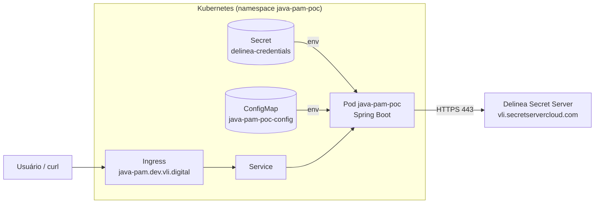
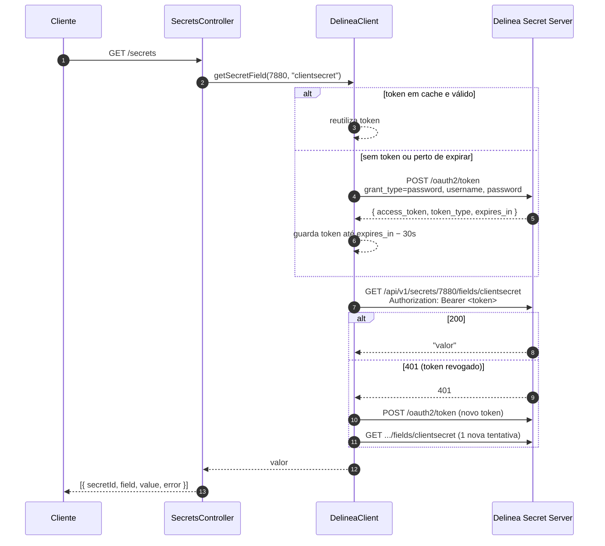

# Arquitetura e guia de integração — Delinea Secret Server

Este documento descreve como a POC obtém secrets do Delinea Secret Server, o que é preciso para
usar o mesmo mecanismo em outro backend e quais cuidados tomar.

Como executar a POC: [README.md](../README.md).

---

## 1. Visão geral

A aplicação recebe **usuário, senha e endereço** do Secret Server, troca essas credenciais por um
**token OAuth2** e usa o token para ler **campos de secrets** pela REST API.



- **Secret do Kubernetes**: guarda só o usuário e a senha do Delinea (a credencial "inicial").
- **ConfigMap**: endereço do Delinea e lista de secrets a ler. Nada sensível.
- **Delinea**: fonte de verdade de todos os demais secrets da aplicação.

---

## 2. Fluxo de chamadas



### Contrato HTTP (independe de linguagem)

**1. Obter token**

```http
POST {BASE_URL}/oauth2/token
Content-Type: application/x-www-form-urlencoded

grant_type=password&username=<USUARIO>&password=<SENHA>
```

Resposta (campos usados):

```json
{ "access_token": "...", "token_type": "bearer", "expires_in": 1200 }
```

**2. Ler um campo de um secret**

```http
GET {BASE_URL}/api/v1/secrets/{secretId}/fields/{slug}
Authorization: Bearer <access_token>
```

A resposta é o valor do campo. O código aceita tanto o valor puro quanto entre aspas (string JSON).

Fontes:
- Autenticação por token: https://docs.delinea.com/online-help/secret-server-11-5-x/api-scripting/authenticating/index.htm
- Campos `access_token`, `token_type`, `expires_in` (exemplo Perl oficial): https://docs.delinea.com/online-help/secret-server-11-5-x/api-scripting/rest-api-perl-scripts/index.htm
- Itens e `slug` de um secret (exemplo Python oficial): https://docs.delinea.com/online-help/secret-server-11-5-x/api-scripting/rest-api-python3-scripts/index.htm

> A referência completa de endpoints da sua versão fica na própria instância (link "REST API" na
> interface do Secret Server). A documentação pública não detalha o formato da resposta de
> `/fields/{slug}`; valide com um `curl` na sua instância.

---

## 3. Componentes da POC

| Classe | Responsabilidade | Reutilizável em outro backend? |
|---|---|---|
| `config/DelineaProperties` | Lê e valida `delinea.*` (URL, usuário, senha, timeouts, lista de secrets) | **Sim** |
| `client/TokenResponse` | Mapeia a resposta de `/oauth2/token`; `toString()` não expõe o token | **Sim** |
| `client/DelineaClient` | Obtém e guarda o token; lê campos; renova o token em caso de 401 | **Sim** (núcleo da integração) |
| `web/SecretsController` | Expõe `GET /secrets` para demonstração | **Não** — só para a POC |
| `PamPocApplication` | Classe main com `@ConfigurationPropertiesScan` | Só a anotação |

### `DelineaClient` — métodos

| Método | Visibilidade | O que faz |
|---|---|---|
| `getSecretField(int secretId, String fieldSlug)` | `public` | Retorna o valor do campo. Usa o token em cache; se receber 401, renova e tenta 1 vez |
| `describe(Exception e)` | `public static` | Monta mensagem de erro legível (status HTTP + corpo do Delinea) |
| `getToken()` | `private synchronized` | Retorna o token em cache ou chama `POST /oauth2/token` |
| `invalidateToken()` | `private synchronized` | Descarta o token em cache |
| `fetchField(...)` | `private` | Faz o `GET /api/v1/secrets/{id}/fields/{slug}` |
| `unquoteJsonString(...)` | `private static` | Remove aspas se o valor vier como string JSON |

Decisões:

- **Cache do token** até `expires_in − 30s`: evita uma chamada de login por leitura.
- **`synchronized` no token**: várias requisições simultâneas não disparam vários logins.
- **Timeouts explícitos** (`connect-timeout`, `read-timeout`): o Delinea lento não trava threads indefinidamente.
- **Credenciais só por variável de ambiente**: nada sensível no `application.yaml` versionado.

---

## 4. Requisitos para usar em outro backend

### 4.1 Infraestrutura e acesso

| Requisito | Detalhe |
|---|---|
| Usuário no Delinea | usuário dedicado à aplicação (não use usuário pessoal), com permissão **somente de leitura** nos secrets necessários |
| IDs e slugs | ID numérico de cada secret e o slug do campo (ex.: `clientsecret`, `password`, `username`) |
| Rede | saída HTTPS do cluster para `vli.secretservercloud.com:443` (verificar NetworkPolicy, proxy, firewall) |
| Secret no Kubernetes | com `DELINEA_USERNAME` e `DELINEA_PASSWORD` no namespace da aplicação |

### 4.2 Stack

| Item | Versão mínima | Motivo |
|---|---|---|
| Java | 17 (POC usa 21) | requisito do Spring Boot 3+ |
| Spring Boot | **3.2+** ou 4.x | `RestClient` existe a partir do Spring Framework 6.1 (Boot 3.2) |

Fonte `RestClient`: https://docs.spring.io/spring-framework/reference/integration/rest-clients.html

---

## 5. Passo a passo de integração (Spring Boot)

### 5.1 Dependências

**Spring Boot 4.x**

```xml
<dependency>
  <groupId>org.springframework.boot</groupId>
  <artifactId>spring-boot-starter-webmvc</artifactId>
</dependency>
<dependency>
  <groupId>org.springframework.boot</groupId>
  <artifactId>spring-boot-starter-validation</artifactId>
</dependency>
```

**Spring Boot 3.2+**

```xml
<dependency>
  <groupId>org.springframework.boot</groupId>
  <artifactId>spring-boot-starter-web</artifactId>
</dependency>
<dependency>
  <groupId>org.springframework.boot</groupId>
  <artifactId>spring-boot-starter-validation</artifactId>
</dependency>
```

Se o backend for WebFlux (reativo), troque `starter-web`/`starter-webmvc` por `spring-boot-starter-webflux`:
o `RestClient` continua funcionando, mas é bloqueante. Chame-o fora do event loop (ex.: na inicialização
ou via `Mono.fromCallable(...).subscribeOn(Schedulers.boundedElastic())`).

Opcional, para health check: `spring-boot-starter-actuator`.

### 5.2 Classes a copiar

Copie para o pacote do seu projeto (ajustando o `package`):

```
config/DelineaProperties.java
client/TokenResponse.java
client/DelineaClient.java
```

**Não** copie o `SecretsController`.

Na classe main, habilite o binding das properties:

```java
@SpringBootApplication
@ConfigurationPropertiesScan
public class MinhaAplicacao { ... }
```

(ou `@EnableConfigurationProperties(DelineaProperties.class)` numa classe `@Configuration`).

### 5.3 Configuração inicial (`application.yaml`)

```yaml
delinea:
  base-url: ${DELINEA_BASE_URL:https://vli.secretservercloud.com}
  username: ${DELINEA_USERNAME:}   # default vazio: força falha do @NotBlank se não definido
  password: ${DELINEA_PASSWORD:}
  connect-timeout: 5s
  read-timeout: 10s
  secrets: []   # opcional: só é usado pelo controller da POC
```

### 5.4 Uso no código

Injete o `DelineaClient` e chame `getSecretField`. Mantenha IDs e slugs em configuração, não no código:

```yaml
app:
  integracao-x:
    secret-id: 7880
    secret-field: clientsecret
```

```java
@Service
public class IntegracaoXService {

    private final DelineaClient delineaClient;
    private final int secretId;
    private final String secretField;

    public IntegracaoXService(
            DelineaClient delineaClient,
            @Value("${app.integracao-x.secret-id}") int secretId,
            @Value("${app.integracao-x.secret-field}") String secretField) {
        this.delineaClient = delineaClient;
        this.secretId = secretId;
        this.secretField = secretField;
    }

    public void chamarApiExterna() {
        String clientSecret = delineaClient.getSecretField(secretId, secretField);
        // usar clientSecret na chamada; nunca logar o valor
    }
}
```

`getSecretField` lança `RestClientException` (ex.: `HttpClientErrorException`, `ResourceAccessException`)
em caso de falha. Trate no ponto de uso conforme a criticidade: falhar a requisição, usar valor em
cache, etc.

### 5.5 Quando ler o secret

| Estratégia | Quando usar | Trade-off |
|---|---|---|
| **Sob demanda** (a cada uso, como na POC) | secrets que podem ser rotacionados a qualquer momento | uma chamada HTTP por leitura; o Delinea vira dependência em tempo de execução |
| **Na inicialização** (ler uma vez e guardar em memória) | senha de banco, client secret estável | rotação exige restart do pod; se o Delinea estiver fora, o pod não sobe |
| **Cache com expiração** (ex.: Caffeine, 5–15 min) | meio-termo | rotação reflete após a expiração; precisa de dependência extra |

> A POC implementa só a leitura sob demanda. As outras estratégias não foram testadas aqui.

### 5.6 Kubernetes

No Deployment da outra aplicação, injete as credenciais do Delinea a partir do Secret:

```yaml
envFrom:
  - secretRef:
      name: delinea-credentials
env:
  - name: DELINEA_BASE_URL
    value: "https://vli.secretservercloud.com"
```

Crie o Secret no namespace da aplicação:

```bash
kubectl -n <NAMESPACE> create secret generic delinea-credentials \
  --from-literal=DELINEA_USERNAME='<USUARIO>' \
  --from-literal=DELINEA_PASSWORD='<SENHA>'
```

Fonte: https://kubernetes.io/docs/tasks/inject-data-application/distribute-credentials-secure/

---

## 6. Backends em outras linguagens

O mecanismo é só HTTP (seção 2). Em qualquer linguagem:

1. Ler `DELINEA_BASE_URL`, `DELINEA_USERNAME`, `DELINEA_PASSWORD` do ambiente.
2. `POST /oauth2/token` com `application/x-www-form-urlencoded`.
3. Guardar `access_token` até `expires_in` (com margem).
4. `GET /api/v1/secrets/{id}/fields/{slug}` com `Authorization: Bearer`.
5. Em 401, renovar o token e tentar uma vez.

A Delinea publica exemplos oficiais em outras linguagens:
- PowerShell: https://docs.delinea.com/online-help/secret-server/api-scripting/rest-api/rest-api-powershell-scripts/index.htm
- Python: https://docs.delinea.com/online-help/secret-server-11-5-x/api-scripting/rest-api-python3-scripts/index.htm
- Perl: https://docs.delinea.com/online-help/secret-server-11-5-x/api-scripting/rest-api-perl-scripts/index.htm
- Clientes gerados via OpenAPI (Java, C# etc.): https://docs.delinea.com/online-help/secret-server/api-scripting/rest-api/rest-api-client-generation/index.htm

---

## 7. Segurança — checklist para produção

- [ ] Não expor endpoints que devolvam secrets (o `/secrets` da POC é só demonstração).
- [ ] Nunca logar valores de secrets nem o token (o `TokenResponse.toString()` já omite o token).
- [ ] Usuário do Delinea dedicado por aplicação, com permissão mínima (só os secrets necessários, só leitura).
- [ ] Senha do usuário do Delinea com rotação definida.
- [ ] Restringir acesso ao Secret do Kubernetes por RBAC.
- [ ] NetworkPolicy liberando egress só para o Delinea e o que mais a aplicação precisar.
- [ ] Definir o comportamento quando o Delinea estiver indisponível (falhar rápido vs. usar cache).

---

## 8. Limitações conhecidas da POC

| Limitação | Impacto | Possível evolução |
|---|---|---|
| Login com `grant_type=password` | depende de usuário e senha guardados no cluster | avaliar refresh token ou, se o tenant migrar para o Delinea Platform, `client_credentials` em `/identity/api/oauth2/token/xpmplatform` |
| Não usa `refresh_token` | a cada expiração faz um novo login completo | implementar `grant_type=refresh_token` ([doc](https://docs.delinea.com/online-help/secret-server-11-6-x/authentication/enable-refresh-token/index.htm)) |
| Sem cache dos valores | uma chamada ao Delinea por leitura | cache com expiração (seção 5.5) |
| Sem retry para erros de rede | uma falha transitória vira erro | Spring Retry / Resilience4j |
| Health check não verifica o Delinea | o pod fica `UP` mesmo sem acesso ao Delinea | `HealthIndicator` próprio, fora dos grupos liveness/readiness para não reiniciar o pod por falha externa |
| Não usa o cliente gerado via OpenAPI | só cobre os 2 endpoints usados | gerar o cliente se precisar de mais endpoints |

Referência do Delinea Platform: https://docs.delinea.com/online-help/platform-api/secret-server-apis-from-platform.htm
